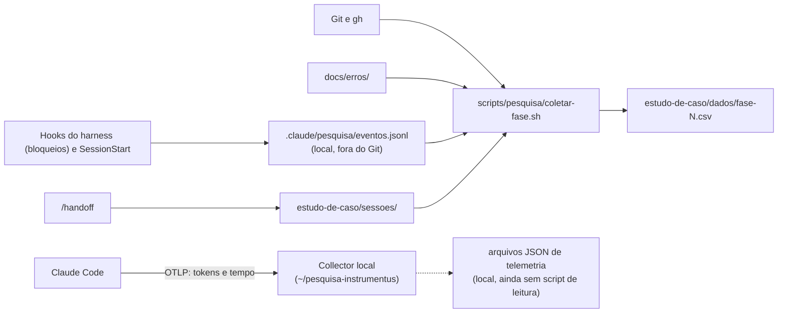

# Estudo de caso: o desenvolvimento com IA

**Esta pasta responde:** como o projeto foi construído com IA e que números sustentam isso?

Não confundir com as pesquisas que os usuários montam no produto, nem com os métodos de pesquisa
([produto/](../produto/README.md) e [metodos/](../metodos/README.md)). Nome anterior desta pasta: `docs/pesquisa/`
(o ADR 0007, que está aceito e por isso não se edita, ainda cita esse nome).

| Arquivo | Do que trata | Status |
|---|---|---|
| [protocolo.md](protocolo.md) | questões, taxonomia de intervenção humana, métricas e fontes | rascunho |
| [sessoes/](sessoes/README.md) | um registro por sessão de trabalho (intervenções, bloqueios, erros da IA, testes) | vigente (índice; registros a coletar) |
| [dados/](dados/README.md) | tabelas por fase (`fase-1.csv`) | vigente |

**Mantida por:** manual (protocolo), `/handoff` (sessoes), `scripts/pesquisa/coletar-fase.sh` (dados).

**Fora desta pasta:** as rotinas ficam em [help/ferramentas/](../help/README.md):
`telemetria.md`, `eventos-do-harness.md` e `coleta-por-fase.md`.

## Por onde os dados passam

